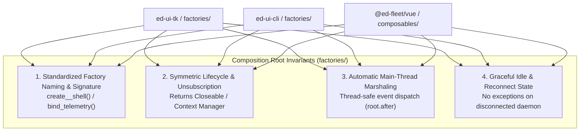

# ADR 0003: Per-Package Composition Root Architecture, Behavioral Invariants, and Automated Enforcement

- **Status:** Proposed
- **Date:** 2026-11-15
- **Context:** `ed-ui` (`architecture/adr/0001_ed_ui_monorepo_architecture.md`, `architecture/adr/0002_quality_gates_and_boundary_enforcement.md`)

## 1. Context & Problem Statement

In the `ed-ui` monorepo, presentation adapters (`ed-ui-tk`, `ed-ui-cli`, `@ed-fleet/vue`) are distributed independently to package registries (PyPI and npm). As established in ADR 0001:
- A singular, monorepo-level composition root is an anti-pattern: an EDMC plugin developer executing `pip install ed-ui-tk` does not install `ed-ui-cli` or Node.js assets, meaning a top-level composition root would fail with `ImportError`.
- Consequently, each deployable presentation adapter must maintain its own **local composition root** (`factories/` in Python packages, `composables/` in Vue).

However, without explicit governance, local composition roots across different presentation packages can easily diverge:
1. **Behavioral Inconsistency (Fragmented DX):** One package requiring manual thread marshaling while another automates it; inconsistent naming (`create_shell` vs. `build_window` vs. `mount_hud`); divergent theme parameter conventions.
2. **Lifecycle & Resource Leakage:** Factories subscribing to `ed-fleet-client` event streams without providing teardown handles or auto-unsubscribing when windows close.
3. **Layer Pollution:** Composition logic leaking into pure rendering widgets under `components/`, or widgets assuming a specific composition root exists.

## 2. Decision

We establish the **Per-Package Composition Root Architecture & Behavioral Invariant Contract** across all `ed-ui` presentation adapters.

### 2.1 The Quad-Invariant Composition Root Contract

Every composition root in `ed-ui` must strictly adhere to four behavioral invariants:



1. **Invariant 1: Standardized Factory Naming & Parameter Symmetry:**
   - **Shell Assembly:** Each package that exposes a turnkey UI assembly must name the factory `create_<framework>_shell(...)` (e.g., `create_edmc_shell()`, `create_terminal_dashboard()`).
   - **Binding Helper:** Each package that exposes telemetry auto-binding must name the helper `bind_telemetry_client(target, client, ...)` (or `useTelemetryStream(url)` in Vue).
   - **Theme Convention:** All factories accepting styling must declare `theme: str | PaletteToken = "orange_hud"` sourcing directly from `ed_ui_core.domain.theme`.

2. **Invariant 2: Symmetric Lifecycle Management & Zero Resource Leaks:**
   - Any composition root that subscribes to `client.on(...)` or starts a background task must return a lifecycle controller providing an explicit `.close()`, `.destroy()`, or `__enter__` / `__exit__` context manager.
   - When a Tkinter window is destroyed (`<Destroy>` event) or a Vue component is unmounted (`onUnmounted`), the composition root **must automatically unsubscribe** all registered handlers from the client dispatcher to prevent memory leaks and zombie thread callbacks.

3. **Invariant 3: Automatic Main-Thread Concurrency Marshaling:**
   - `ed-fleet-client` delivers SSE events asynchronously on background threads or asyncio event loops.
   - The composition root is **strictly responsible** for crossing the thread boundary safely into the UI framework's main thread (e.g. using `root.after(0, callback)` in Tkinter, queue polling in CLI, or Vue's reactive refs).
   - Individual widgets in `components/` must **never** be required to handle thread synchronization.

4. **Invariant 4: Graceful Degradation & Idle Visual State:**
   - When initialized without a running game daemon or when network disconnects occur, the composition root must transition widget states to `idle` / `disconnected` (dimmed lamps, default indicators) rather than crashing with unhandled exceptions.

---

### 2.2 Directory Placement Invariant

Within every deployable package, composition roots are strictly restricted to dedicated submodules:

| Package | Composition Root Location | Exports via `__init__.py` | Forbidden Inside |
| :--- | :--- | :--- | :--- |
| **`ed_ui_core`** | *None* (Hexagonal Core) | Domain view-models & tokens only | No factories or framework wiring |
| **`ed_ui_tk`** | `src/ed_ui_tk/factories/` | `create_edmc_shell`, `create_cockpit_hud_shell`, `bind_telemetry_client` | Forbidden in `component_sets/`, `themes/` |
| **`ed_ui_cli`** | `src/ed_ui_cli/factories/` | `create_terminal_dashboard`, `run_diagnostic_suite` | Forbidden in `components/` |
| **`@ed-fleet/vue`** | `src/composables/` | `useTelemetryStream`, `install` plugin | Forbidden in SFC `<template>` / components |

---

### 2.3 Pluggable Component Set Architecture & Factory Plurality

To support distinct visual design paradigms within a single framework package (e.g. classic EDMC plugin UI vs. modern glass cockpit HUD vs. native ttk widgets in `ed_ui_tk`), presentation packages organize rendering elements into **Pluggable Component Sets** governed by two consumption layers:

1. **Pluggable Directory Taxonomy (`component_sets/`):**
   ```text
   python/ed_ui_tk/src/ed_ui_tk/
   ├── component_sets/
   │   ├── legacy_edmc/            # Component Set A: Classic EDMC plugin key-value grids & status bars
   │   │   ├── status_bar.py
   │   │   ├── key_value_grid.py
   │   │   └── settings_dialog.py
   │   │
   │   ├── modern_hud/             # Component Set B: Rich Canvas-based HUD gauges & vector compasses
   │   │   ├── pip_arc_gauge.py
   │   │   ├── vector_compass.py
   │   │   └── annunciator_matrix.py
   │   │
   │   └── ttk_standard/           # Component Set C: Standard native OS themed controls
   │       ├── cargo_table.py
   │       └── route_tree.py
   │
   ├── themes/                     # Shared Tkinter style & color palette managers
   │   ├── edmc_theme.py           # Dark / Light / Transparent EDMC themes
   │   └── orange_hud_theme.py     # Authentic Elite Dangerous amber glow
   │
   └── factories/                  # Composition Roots
       ├── edmc_shell.py           # Specialized root: wires legacy_edmc component set
       ├── cockpit_hud.py          # Specialized root: wires modern_hud component set
       └── binder.py               # Generic binder: inspects and wires ANY component set
   ```

2. **Specialized Factory Roots vs. Generic Binder Roots:**
   - **Specialized Assemblies:** Pre-wire complete turnkey assemblies for specific component sets:
     - `create_edmc_shell(parent, client, ...)`: Composes classic `legacy_edmc` plugin frames.
     - `create_cockpit_hud_shell(parent, client, ...)`: Composes modern canvas-driven glass cockpit HUDs.
   - **Generic Auto-Binder (`bind_telemetry_client`):** Accepts an arbitrary widget tree containing widgets from *any* component set (or user-authored custom widgets adhering to display protocols). It traverses the widget hierarchy, hooks into `ed-fleet-client` event types, and automates thread marshaling and unsubscription.

---

### 2.4 Automated Architectural Enforcement

Compliance with these invariants is verified deterministically through the automated quality gate pipeline established in ADR 0002:

1. **AST Factory Isolation Test (`tests/architecture/test_factory_isolation.py`):**
   - Traverses all `.py` files outside `factories/`.
   - Asserts that no file in `components/` or `themes/` imports `ed_fleet_client`, registers event callbacks, or calls `create_client`.
   - Asserts that all factory files export symmetric teardown/lifecycle methods.

2. **Thread Safety Verification Test (`tests/unit/test_tk_binder.py`):**
   - Simulates background event delivery from a mock thread into `bind_telemetry_client()`.
   - Asserts that widget mutations occur exclusively via Tkinter's `after()` queue and never directly from the caller thread.

3. **Unsubscription Lifecycle Test (`tests/unit/test_lifecycle.py`):**
   - Instantiates a factory shell, triggers widget destruction, and verifies that the `client.dispatcher` active subscription count returns to zero.

## 3. Consequences

- **Positive:**
  - **Predictable Developer UX:** Developers transitioning between `ed-ui-tk`, `ed-ui-cli`, and `@ed-fleet/vue` experience uniform factory patterns, naming conventions, and theme tokens.
  - **Memory & Thread Safety:** Automating lifecycle unsubscription and main-thread marshaling inside factories prevents UI freezing, race conditions, and memory leaks across long game sessions.
  - **Strict Architectural Cleanliness:** Keeps components pure and reusable; developers can still import widgets directly without being forced to use the composition root if they have their own custom wiring.
- **Negative / Trade-offs:**
  - Factories must manage internal reference tracking to ensure clean teardown, slightly increasing the complexity of `factories/binder.py`.
