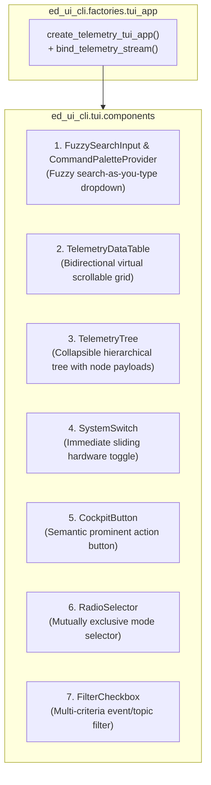

# ADR 0004: Interactive TUI Component Library and Composition Root Architecture for ed-ui-cli

- **Status:** Accepted
- **Date:** 2026-11-16
- **Context:** `ed-ui` (`architecture/adr/0001_ed_ui_monorepo_architecture.md`, `architecture/adr/0003_composition_roots_and_behavioral_invariants.md`, and integration smoke evaluations in `cli_ui_elements_evaluation_ledger.md`)

---

## 1. Context & Problem Statement

In SDD-003 and ADR 0003, `ed-ui-cli` was established as the terminal presentation adapter for the *Elite Dangerous* software fleet, introducing initial Rich metric widgets, line formatters, and a baseline full-screen Textual application shell (`BaseTelemetryTUIApp`).

However, developer tools and integration workbenches (such as `ed-integration-smoke` and future `ed-sdk` CLI utilities) require richer interactive capabilities to inspect live telemetry streams, navigate complex celestial cartography, and control streaming hardware states. Evaluating modern terminal interfaces in `cli_ui_elements_evaluation_ledger.md` surfaced several critical interactive patterns absent from `ed-ui-cli`:

1. **Fuzzy Search & Fast Autocomplete:** Searching through thousands of star systems, stations, or telemetry event names requires real-time substring/fuzzy filtering with attached dropdowns.
2. **Dense Bidirectional Data Tables:** Inspecting wide telemetry logs and market prices requires virtualized two-dimensional ($X$ and $Y$ axis) scrolling with pinned headers and row selection.
3. **Hierarchical / Recursive Explorers:** Visualizing stellar systems (star $\rightarrow$ planets $\rightarrow$ moons) and deep nested telemetry JSON DTOs requires an accordion-style collapsible tree.
4. **Immediate Operational Hardware Controls:** Cockpit toggles and live streaming controllers need distinctive sliding switches (`Switch`), prominent action buttons (`Button`), mutually exclusive mode selectors (`RadioSet`), and filter checkboxes (`Checkbox`).

Without standardized, reusable component wrappers in `ed-ui-cli`, individual scripts and applications will repeatedly re-implement ad-hoc controls, creating visual fragmentation and leaking raw Textual widget setup into application business logic.

---

## 2. Decision

We decide to expand `ed-ui-cli` with a dedicated suite of seven interactive TUI components and integrate them into the `ed-ui-cli` composition root architecture (`ed_ui_cli.factories` and `ed_ui_cli.tui.components`).

### 2.1 Component Specifications

The component library standardizes seven core interactive elements:

#### 1. Fuzzy Search Dropdown & Command Palette (`FuzzySearchInput` & `CommandPaletteProvider`)
* **Behavior:** An input widget paired with a dynamic overlay `OptionList` that updates candidate matches as the operator types, enabling arrow-key traversal and Enter selection.
* **TUI Integration:** Extends Textual `Input` and exports a reusable `CommandPaletteProvider` allowing any host `App` to expose searchable telemetry routines via `Ctrl+P`.
* **Use Case:** Star system search, station lookups, and journal event filter queries.

#### 2. Bidirectional Scrollable DataTable (`TelemetryDataTable`)
* **Behavior:** High-performance tabular display supporting virtualized $X$-axis (horizontal) and $Y$-axis (vertical) scrolling.
* **Capabilities:** Pinned column headers (`fixed_rows=1`), pinned identifier column (`fixed_columns=1`), configurable cursor modes (`row`, `cell`, `none`), and row-selection event emission.
* **Use Case:** Telemetry event history logs, star system body cartography ledgers, and market commodity prices.

#### 3. Collapsible Hierarchical Tree View (`TelemetryTree`)
* **Behavior:** Accordion-style tree with expandable and collapsible parent nodes, leaf nodes, and arbitrary Python payload attachment (`node.data`).
* **Use Case:**
  * Star system cartography (Primary Star $\rightarrow$ Planets $\rightarrow$ Moons $\rightarrow$ Surface Stations).
  * Real-time JSON DTO inspector: clicking on an event payload allows inspecting nested attributes without terminal clutter.
  * Workspace directory topologies.

#### 4. Sliding Switch Toggle (`SystemSwitch`)
* **Behavior:** Animated sliding pill toggle representing an immediate hardware or network state transition (`ON`/`OFF`), emitting `SystemSwitch.Changed` events.
* **Difference from Checkbox:** Used exclusively for active stream/hardware toggles taking immediate effect (e.g., `Live SSE Stream`, `Flight Assist`), whereas checkboxes denote passive criteria filters.

#### 5. Large Semantic Action Buttons (`CockpitButton`)
* **Behavior:** Prominent action buttons styled with heavy borders and semantic variants: `primary`, `success`, `warning`, and `error`.
* **Use Case:** Urgent action triggers: `POLL NOW`, `PURGE CACHE`, `RECONNECT`, `CLEAR LOGS`.

#### 6. Radio Button Groups (`RadioSelector`)
* **Behavior:** Enclosed `RadioSet` housing mutually exclusive `RadioButton` elements with keyboard arrow navigation.
* **Use Case:** Data plane selection: `Live Journal (SSE)` vs `HTTP Polling` vs `Offline Mock`.

#### 7. Filter Checkboxes (`FilterCheckbox`)
* **Behavior:** Square indicator toggles (`[X]` vs `[ ]`) with reactive state binding.
* **Use Case:** Multi-criteria event filtering (`[X] Navigation`, `[X] Combat`, `[X] Status`, `[ ] Market DTOs`).

---

### 2.2 Composition Root Integration

Adhering to ADR 0003:
1. All interactive widgets are exposed through clean factory constructors and turnkey layout builders in `ed_ui_cli.factories`.
2. The primary composition root `create_telemetry_tui_app()` is enhanced to mount these widgets into a responsive multi-pane layout:
   * **Header / Command Palette:** Global fuzzy search bar (`Ctrl+P`).
   * **Left Sidebar (Navigation & Controls):** `TelemetryTree` for cartography/JSON inspection, `RadioSelector` for data source, `SystemSwitch` for connection state.
   * **Main Center View:** Tabbed pane hosting `TelemetryDataTable` (live event log) and `SingleScreenDashboard` metrics.
   * **Right Sidebar / Action Bar:** Annunciator status grid, `FilterCheckbox` cluster, and `CockpitButton` action bar.
3. Thread-safe event binding continues to be governed by `TuiTelemetryBinder`, cleanly marshaling external SSE payloads to UI widgets via `app.call_from_thread()`.

---

## 3. Consequences

### Positive
* **Unified Component Library:** Provides a single, authoritative library of rich terminal components for all downstream scripts, prototypes, and tools.
* **Adherence to Quad-Invariant Contract:** Encapsulates layout, keyboard navigation, and thread safety inside standard composition roots, preventing UI boilerplates in caller applications.
* **Enhanced Developer Ergonomics:** Operators gain fast keyboard navigation, fuzzy filtering, and deep JSON payload exploration in integration workbenches.

### Negative / Trade-Offs
* **Terminal Emulator Compatibility:** Advanced Textual widgets (such as bidirectional scrollbars and mouse-responsive sliders) require modern terminal emulators supporting ANSI 256/TrueColor and mouse tracking. Graceful fallback text or headless test mocks must be provided for minimal environments.
