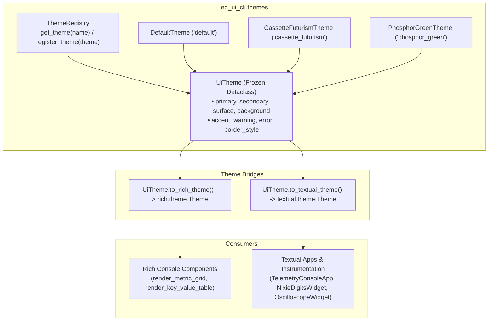

# ADR 0005: CLI/TUI Theming Architecture and Cassette Futurism Instrumentation

- **Status:** Accepted
- **Date:** 2026-11-16
- **Context:** `ed-ui` (`architecture/adr/0001_ed_ui_monorepo_architecture.md`, `architecture/adr/0004_tui_interactive_components_and_composition_roots.md`)

---

## 1. Context & Problem Statement

In ADR 0004 and SDD-004, `ed-ui-cli` established seven interactive Textual components (`FuzzySearchInput`, `TelemetryDataTable`, `TelemetryTree`, `SystemSwitch`, `CockpitButton`, `RadioSelector`, `FilterCheckbox`) and the `TelemetryConsoleApp` composition root.

However, styling across `ed-ui-cli` remains tightly coupled to hardcoded color strings (e.g. `[bold cyan]`, `[bold yellow]`, `$primary: #00e5ff;`). Developers building command-line workbenches, integration test monitors, or embedded cockpit diagnostics cannot customize the visual presentation or adopt distinct thematic aesthetics—such as retro-sci-fi and **Cassette Futurism**—without manually overriding low-level stylesheet rules or duplicating widget templates.

Cassette Futurism evokes 1970s/1980s analog-digital science fiction (*Alien*, *Blade Runner*, NASA Apollo/Shuttle command stations) characterized by:
1. Chunky mechanical borders and rigid bevels (`ascii`, `heavy`, `tall`).
2. Monochrome phosphor displays: P4 Amber (`#ffb000`) and P31 Green (`#33ff00`) over deep charcoal (`#111417`).
3. Hardware instrumentation: Segmented vacuum fluorescent/nixie displays, analog potentiometer sliders, linear LED VU-meters, CRT radar/oscilloscope sweeps, and character-matrix pixel wireframes.

`ed-ui-cli` requires an extensible theming architecture that unifies both Rich console renderables and Textual TUI applications under a single tokenized contract, accompanied by retro hardware instrumentation widgets.

---

## 2. Decision

We decide to:
1. Introduce a unified theming subsystem under `ed_ui_cli.themes` with a frozen `UiTheme` design token contract, theme registry, and bidirectional converters to `rich.theme.Theme` and `textual.theme.Theme`.
2. Provide canonical presets:
   * `DEFAULT_THEME` (`"default"`): Modern Elite Dangerous cockpit cyan, electric blue, and amber accents.
   * `CASSETTE_FUTURISM_THEME` (`"cassette_futurism"`): P4 amber phosphor, charcoal panels, high-contrast alerts, and heavy mechanical borders.
   * `PHOSPHOR_GREEN_THEME` (`"phosphor_green"`): Classic P31 CRT green terminal aesthetic.
3. Integrate theme resolution directly into `BaseTelemetryTUIApp` and `TelemetryConsoleApp`, allowing developers to select a theme via parameter (`theme="cassette_futurism"`) or environment variable (`ED_UI_THEME`).
4. Implement hardware instrumentation components under `ed_ui_cli.tui.components.instrumentation`:
   * `NixieDigitsWidget`: Segmented 7-segment/nixie-tube numeric readouts leveraging Textual `Digits`.
   * `AnalogMeterBar`: Stepped linear LED bar meters utilizing Textual `ProgressBar`.
   * `OscilloscopeWidget` & `RadarSweepWidget`: Character-matrix CRT radar and telemetry sweeps powered by `textual-plotext`.
   * `SpritePixelWidget`: Low-resolution 8-bit/16-bit CRT wireframe/glyph rendering powered by `rich-pixels`.
   * `CanvasPlotWidget`: Procedural vector character-grid drawing surface powered by `textual-canvas`.
   * `ThrottleSliderWidget`: Physical potentiometer/throttle control powered by `textual-slider`.

---

## 3. Architecture & Token Model

---

## 4. Consequences

### Positive
* **Unified Visual Contract:** A single theme choice applies coherently across both static Rich CLI outputs and full-screen Textual TUIs.
* **Declarative Theming:** Third-party applications and scripts in `ed-integration-smoke` or downstream fleets select themes with a single argument (`theme="cassette_futurism"`).
* **Rich Instrumentation:** Retro scientific and flight telemetry visualizations (CRT plots, nixie digits, pixel wireframes) are accessible as standardized components.

### Negative / Trade-offs
* **External Dependencies:** Introduces specialized TUI dependencies (`textual-plotext`, `rich-pixels`, `textual-canvas`, `textual-slider`) to `ed-ui-cli`.
* **Headless Testing Requirements:** Mocking and headless verification must account for terminal plotting and canvas buffers.
