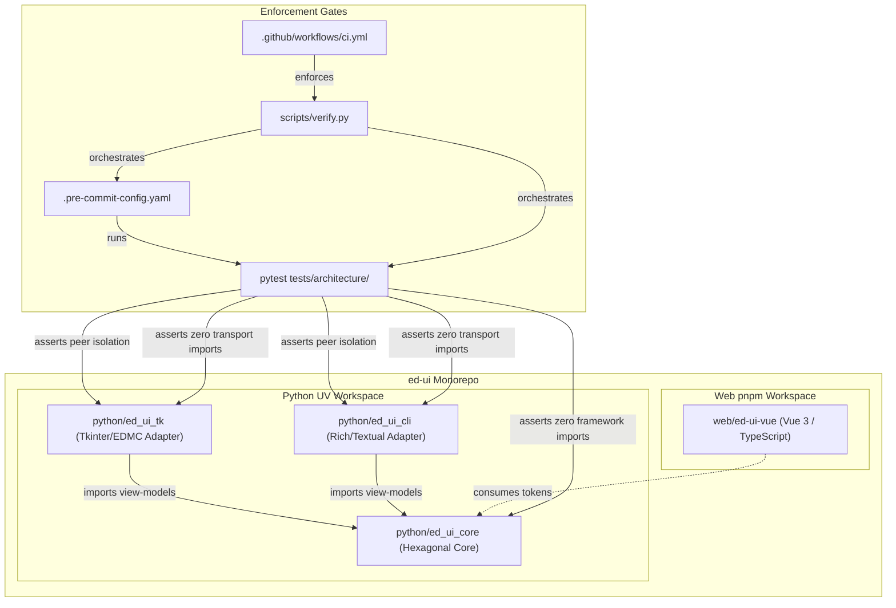
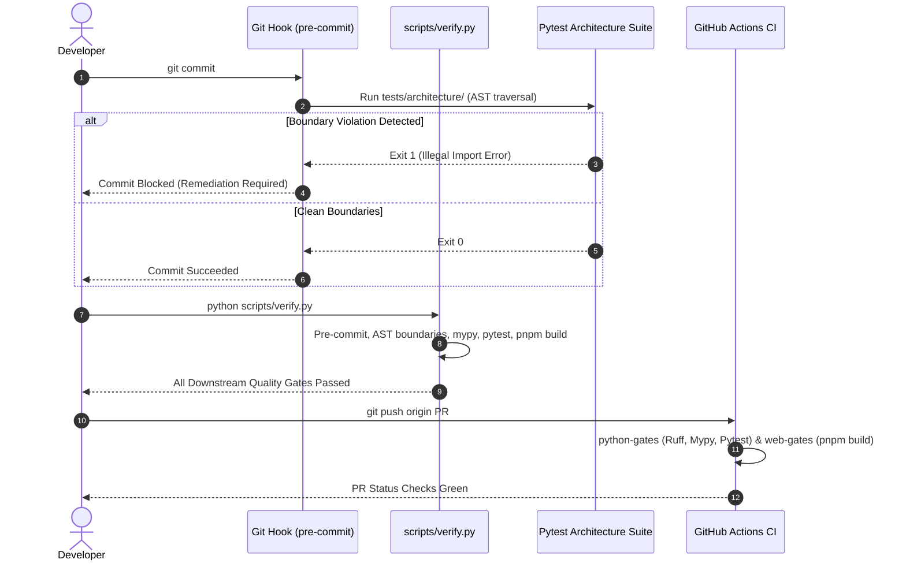

# SDD-001: Quality Gates and Boundary Enforcement Infrastructure

## 1. System Overview & The Skeptic Test

The `ed-ui` monorepo manages multiple packages across two runtime language planes (Python and TypeScript). Standard single-package hexagonal enforcement templates fail in this multi-package architecture because outer presentation adapters (`ed-ui-tk`, `ed-ui-cli`) legitimately adapt inner core view-models, while TypeScript components in `web/` must not be scanned by Python linting tools.

This subsystem provides automated, machine-enforced quality gates preventing:
- UI framework leakage into `ed_ui_core` (`RSK-01`).
- Accidental cross-coupling between presentation peer adapters (`ed_ui_tk` and `ed_ui_cli`).
- Impure presentation widgets instantiating network connections (`RSK-05`).
- Unverified commit submissions to remote repositories.

---

## 2. Visual Architecture Models

### 2.1 Structural Model (Component & Layer Boundaries)

### 2.2 Dynamic Flow (Quality Verification Pipeline)

---

## 3. Subsystem Specifications

### 3.1 Pre-Commit Hooks Configuration (`.pre-commit-config.yaml`)
- `pre-commit-hooks`: file hygiene (`trailing-whitespace`, `end-of-file-fixer`, `check-yaml`, `check-toml`).
- `ruff`: Linter and formatter targeting `python/` with `--fix`.
- `local`: Custom hook running AST architectural compliance tests (`pytest tests/architecture/`).

### 3.2 Automated Architecture Tests (`tests/architecture/`)
- `tests/architecture/test_core_isolation.py`:
  - Parses AST of all `.py` files in `python/ed_ui_core/src/ed_ui_core/`.
  - Asserts that no imported module name matches `tkinter`, `_tkinter`, `rich`, `textual`, `httpx`, `requests`, `fastapi`, `flask`.
- `tests/architecture/test_peer_isolation.py`:
  - Parses AST of `python/ed_ui_tk/` asserting zero imports from `ed_ui_cli` or `rich`/`textual`.
  - Parses AST of `python/ed_ui_cli/` asserting zero imports from `ed_ui_tk` or `tkinter`.
- `tests/architecture/test_component_purity.py`:
  - Parses AST of `components/` subdirectories across all packages asserting zero imports of network libraries (`httpx`, `urllib.request`, `socket`).

### 3.3 Verification Runner (`scripts/verify.py`)
Executable orchestrating:
1. Pre-commit hooks across all files.
2. Architecture boundary assertions (`pytest tests/architecture/`).
3. Static type checking (`mypy python/`).
4. Unit test suite (`pytest tests/unit/`).
5. Web package compilation (`pnpm --prefix web/ed-ui-vue run build` if pnpm present).

### 3.4 GitHub Actions CI Workflow (`.github/workflows/ci.yml`)
- Triggered on `pull_request` and `push` to `main`.
- Job 1: `python-quality` (runs on Python 3.13, executes ruff, mypy, pytest).
- Job 2: `web-quality` (runs on Node.js 20 with pnpm, executes typecheck and build).

---

## 4. Implementation Phasing & Verification

- [x] **Milestone 1:** Author SDD-001 and register in `architecture/designs/`.
- [ ] **Milestone 2:** Implement `tests/architecture/` (`test_core_isolation.py`, `test_peer_isolation.py`, `test_component_purity.py`).
- [ ] **Milestone 3:** Implement `.pre-commit-config.yaml` and root `pyproject.toml` tool sections (Ruff, MyPy, Pytest).
- [ ] **Milestone 4:** Implement `scripts/verify.py` executable.
- [ ] **Milestone 5:** Implement `.github/workflows/ci.yml`.
- [ ] **Milestone 6:** Execute full verification via `scripts/verify.py`, commit, push to branch, and update PR #1.
