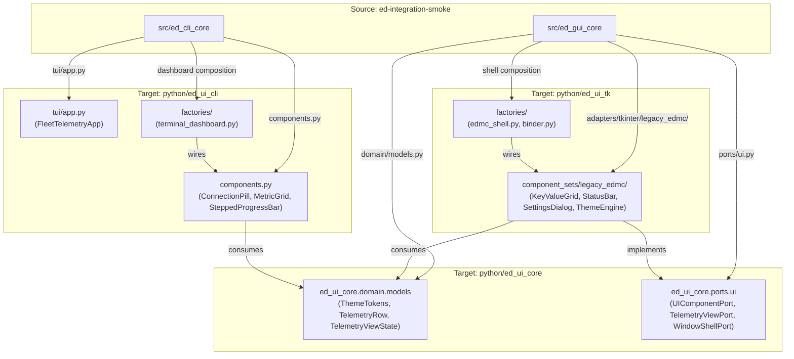
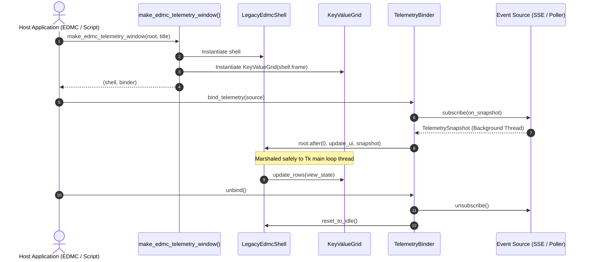

# SDD-002: Component Migration, Component Set Architecture, and Composition Roots

## 1. System Overview & The Skeptic Test

The `ed-ui` monorepo establishes a unified presentation tier for the Elite Dangerous fleet tools. Currently, presentation components reside in the `ed-integration-smoke` repository inside exploratory packages `src/ed_gui_core` and `src/ed_cli_core`.

These components are fragmented:
1. `src/ed_gui_core` bundles UI-agnostic presentation models, Tkinter widgets, and application window shells into a single package without enforcement boundaries.
2. `src/ed_cli_core` bundles Rich widgets, Textual apps, and CLI command options in one flat structure.
3. Neither package implements standardized composition roots, lifecycle unsubscription, or thread-marshaling invariants.

Migrating these components into `ed-ui` without an explicit architectural design would replicate existing technical debt and risk framework leakage across package boundaries.

This design document specifies:
- The exact package and directory decomposition of legacy components into `python/ed_ui_core`, `python/ed_ui_tk`, and `python/ed_ui_cli`.
- The organization of Tkinter components into pluggable component sets (`component_sets/legacy_edmc/`).
- The concrete implementation of composition root factories and telemetry binders adhering to the quad-invariants defined in ADR 0003.

---

## 2. Visual Architecture Models

### 2.1 Structural Model (Component & Package Mapping)

### 2.2 Dynamic Flow (Telemetry Composition Root Lifecycle)

---

## 3. Package & Module Placement Details

### 3.1 `python/ed_ui_core` (Agnostic Domain & Protocols)

This package contains zero graphical library dependencies (`tkinter`, `rich`, `textual` are strictly forbidden).

- `ed_ui_core/domain/models.py`:
  - `ThemeMode` (Enum: `DEFAULT`, `DARK`, `TRANSPARENT`)
  - `ThemeTokens` (Tokens for foreground, background, highlight, font sizing)
  - `TelemetryRow` (Row presentation state: `key`, `label`, `value`, `url`, `visible`)
  - `TelemetryViewState` (Aggregated view state for multi-row displays)
  - `SettingsTabDescriptor` (Tab descriptor metadata)
- `ed_ui_core/ports/ui.py`:
  - `UIComponentPort` (Base protocol for mountable visual components)
  - `TelemetryViewPort` (Protocol for displaying `TelemetryViewState`)
  - `WindowShellPort` (Protocol for root window management)
  - `ThemeApplierPort` (Protocol for applying theme tokens to widget trees)

### 3.2 `python/ed_ui_tk` (Tkinter & Component Sets)

- `ed_ui_tk/component_sets/legacy_edmc/`:
  - `telemetry.py`: `KeyValueGrid`, `StatusBar`, `HyperlinkText`
  - `settings.py`: `SettingsDialog`, `NotebookSettingsShell`
  - `theme.py`: `LegacyEdmcThemeEngine`
- `ed_ui_tk/factories/`:
  - `edmc_shell.py`: `create_edmc_shell()`, `make_edmc_telemetry_window()` (adheres to ADR 0003 naming invariant)
  - `binder.py`: `TkTelemetryBinder` (handles `root.after` marshaling and symmetric unbind)

### 3.3 `python/ed_ui_cli` (Rich & Textual)

- `ed_ui_cli/components.py`:
  - `render_connection_pill()`, `render_metric_grid()`, `render_stepped_progress()`, `render_snapshot_table()`
- `ed_ui_cli/tui/app.py`:
  - `FleetTelemetryApp` (Textual reactive TUI app)
- `ed_ui_cli/factories/`:
  - `terminal_dashboard.py`: `create_terminal_dashboard()`, `create_snapshot_viewer()`

---

## 4. Verification Checklists & Quality Invariants

1. **Architecture Test Invariants (`tests/architecture/`):**
   - Assert `python/ed_ui_core` has zero imports of `tkinter`, `rich`, `textual`, or `pygame`.
   - Assert `python/ed_ui_tk` does not import `rich` or `textual`.
   - Assert `python/ed_ui_cli` does not import `tkinter`.
2. **Behavioral Invariants (ADR 0003):**
   - Composition root factories prefix functions with `create_` or `make_`.
   - Binders return an unbind callback or object implementing `.unbind()`.
   - Thread safety: updates to Tkinter components are marshaled through `root.after()`.
   - Tests assert idle state on unbind.
3. **Automated Verification:**
   - `.venv/bin/python scripts/verify.py` passes all ruff, mypy, architecture tests, and unit tests cleanly.
