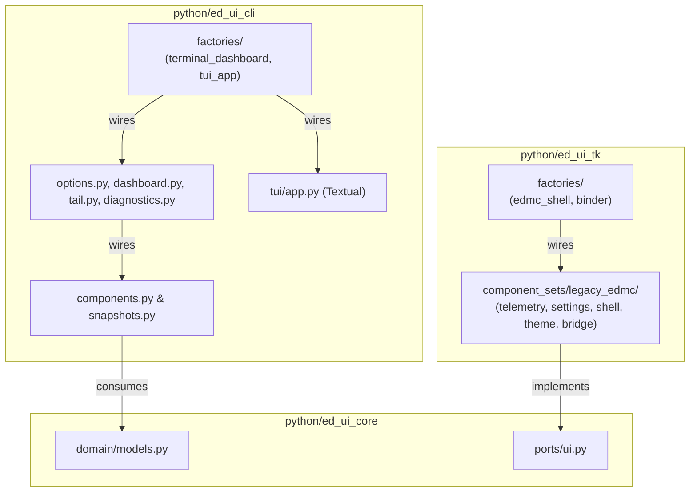
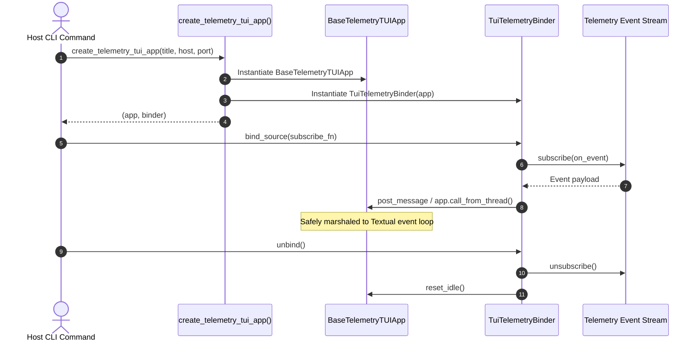

# SDD-003: Completion of CLI/GUI Core Migration and Composition Roots

## 1. System Overview & The Skeptic Test

In SDD-002, initial presentation domain models, Tkinter widgets, and terminal metric components were migrated into `ed-ui`. However, several operational CLI harness modules and Tkinter extension primitives remain in `ed-integration-smoke`:
1. `ed_gui_core/adapters/tkinter/legacy_edmc/bridge.py` (`TkEventBridge`, `PluginSlot`, `PluginSettingsRegistry`): Required by host plugins to register custom tabs and hook UI event bridges.
2. `ed_cli_core/options.py`: Standard Typer CLI parameter presets (`HostOption`, `PortOption`, `ApiKeyOption`, `FormatOption`).
3. `ed_cli_core/dashboard.py`: Rich `SingleScreenDashboard` multi-tier layout engine.
4. `ed_cli_core/diagnostics.py`: Live diagnostic reporter and summary table generator.
5. `ed_cli_core/tail.py`: Structured event stream line formatter.
6. `ed_cli_core/tui/app.py`: Full-screen Textual reactive TUI app (`BaseTelemetryTUIApp`, `MetricCardWidget`).

Without these modules, `ed_cli_core` and `ed_gui_core` cannot be decommissioned from `ed-integration-smoke`, and terminal consumers cannot compose complete CLI or TUI applications through standardized composition roots.

This design articulates the complete placement of these remaining modules, incorporates `typer` and `textual` into `python/ed_ui_cli` workspace dependencies, and implements end-to-end composition roots adhering to ADR 0003.

---

## 2. Visual Architecture Models

### 2.1 Structural Model (Complete Package Ecosystem)

### 2.2 Dynamic Flow (Textual Reactive TUI Composition Root Lifecycle)

---

## 3. Placement & Dependency Specifications

### 3.1 Dependencies Updates
- `python/ed_ui_cli/pyproject.toml`:
  - Add `typer>=0.15.0`
  - Add `textual>=1.0.0`

### 3.2 Target Directory Mapping

1. **`python/ed_ui_tk`:**
   - `src/ed_ui_tk/component_sets/legacy_edmc/bridge.py`:
     - `TkEventBridge` implementing `EventBridgePort`
     - `PluginSlot` (dedicated frame container)
     - `PluginSettingsRegistry` implementing `PluginSettingsRegistryPort`
   - Update `factories/edmc_shell.py` to wire `PluginSettingsRegistry` and `TkEventBridge` directly into `AppShell`.

2. **`python/ed_ui_cli`:**
   - `src/ed_ui_cli/options.py`: Standard Typer CLI annotations (`HostOption`, `PortOption`, `ApiKeyOption`, `FormatOption`, `OutputFormat`).
   - `src/ed_ui_cli/dashboard.py`: `SingleScreenDashboard` multi-panel terminal layout.
   - `src/ed_ui_cli/diagnostics.py`: `DiagnosticCheckResult`, `DiagnosticReporter`.
   - `src/ed_ui_cli/tail.py`: `TailEventLine`, `TailLineFormatter`.
   - `src/ed_ui_cli/tui/app.py`: `MetricCardWidget`, `BaseTelemetryTUIApp`.
   - `src/ed_ui_cli/factories/terminal_dashboard.py`:
     - Add `create_single_screen_dashboard()`, `create_diagnostic_reporter()`, `create_tail_formatter()`.
   - `src/ed_ui_cli/factories/tui_app.py`:
     - `create_telemetry_tui_app()`, `TuiTelemetryBinder`.

---

## 4. Verification Checklists & Quality Invariants

1. **Dependency & Boundary Invariants:**
   - Boundary tests (`tests/architecture/`) confirm `ed_ui_core` remains pure and framework-free.
   - `ed_ui_tk` and `ed_ui_cli` maintain mutual peer isolation.
   - Component purity rule: no presentation component directly imports network transport.
2. **Behavioral Invariants (ADR 0003):**
   - All factory functions prefixed with `create_` or `make_`.
   - Binders provide symmetric unsubscription and idle reset.
   - Textual and Tkinter UI calls are marshaled thread-safely.
3. **Execution Verification:**
   - Run `scripts/verify.py` ensuring pre-commit, boundary compliance, static type checking (MyPy), and unit tests pass without error.
