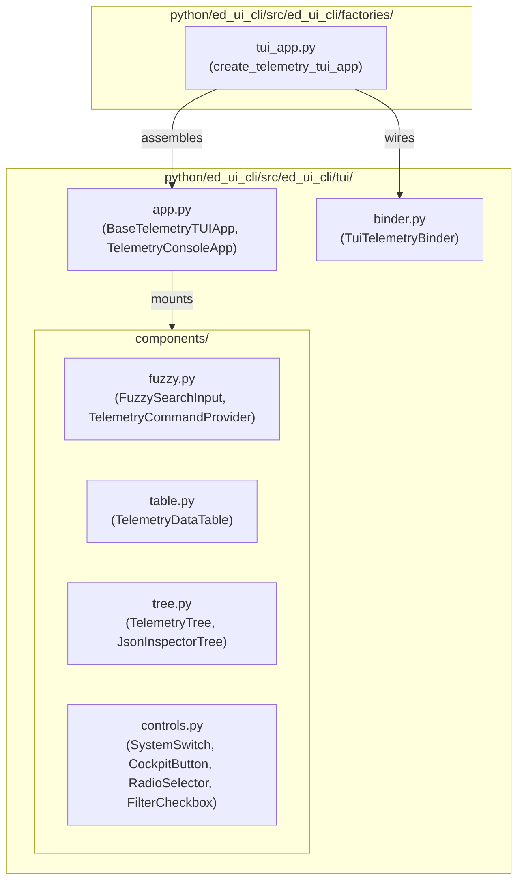
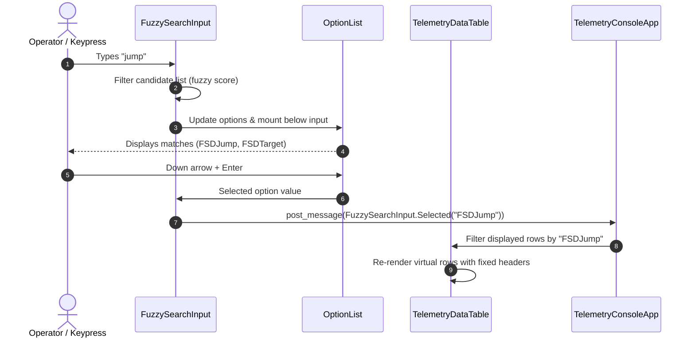

# SDD-004: Interactive TUI Components Implementation, Composition Roots, and Verification Procedures

## 1. System Overview & The Skeptic Test

In SDD-003, `ed-ui-cli` established initial metric cards and the base Textual app shell (`BaseTelemetryTUIApp`). However, interacting with dense telemetry streams, star systems, and hardware configurations requires a rich set of reactive components:
1. Searching star systems or event types is slow and error-prone without an inline fuzzy search dropdown.
2. Reviewing tabular logs without independent $X$ and $Y$ axis scrolling leads to truncated lines or unreadable terminal wraps.
3. Inspecting nested JSON DTOs and hierarchical star systems is unworkable without collapsible tree nodes.
4. Toggling live telemetry streams or switching between data sources requires clear, immediate visual controls (switches, buttons, radio groups).

This design details the exact Python class structures, message contracts, composition root factory signatures, and automated testing procedures for these interactive TUI components in `ed-ui-cli`.

---

## 2. Visual Architecture Models

### 2.1 Structural Layout Model



### 2.2 Dynamic Flow (Fuzzy Search & Table Selection Lifecycle)



---

## 3. Component Class & Contract Specifications

### 3.1 Module Placement
All new components reside in `python/ed_ui_cli/src/ed_ui_cli/tui/components/`:
* `fuzzy.py`: `FuzzySearchInput`, `TelemetryCommandProvider`.
* `table.py`: `TelemetryDataTable`.
* `tree.py`: `TelemetryTree`, `JsonInspectorTree`.
* `controls.py`: `SystemSwitch`, `CockpitButton`, `RadioSelector`, `FilterCheckbox`.

### 3.2 Component Contracts

#### 1. `FuzzySearchInput` (`fuzzy.py`)
```python
from textual.widgets import Input, OptionList
from textual.message import Message

class FuzzySearchInput(Input):
    """Search input paired with an inline dynamic candidate dropdown."""

    class Selected(Message):
        def __init__(self, value: str) -> None:
            self.value = value
            super().__init__()

    def __init__(self, candidates: list[str], placeholder: str = "Search...", **kwargs: Any) -> None:
        ...
```

#### 2. `TelemetryDataTable` (`table.py`)
```python
from textual.widgets import DataTable

class TelemetryDataTable(DataTable):
    """Bidirectional scrollable data grid with pinned headers and virtual rendering."""

    def __init__(
        self,
        columns: list[str],
        fixed_rows: int = 1,
        fixed_columns: int = 1,
        cursor_type: str = "row",
        **kwargs: Any
    ) -> None:
        ...

    def append_event_row(self, timestamp: str, channel: str, event_name: str, payload_summary: str) -> None:
        ...
```

#### 3. `TelemetryTree` and `JsonInspectorTree` (`tree.py`)
```python
from textual.widgets import Tree
from typing import Any

class TelemetryTree(Tree[Any]):
    """Collapsible hierarchical tree with payload attachments."""

    def populate_celestial_system(self, system_name: str, bodies: list[dict[str, Any]]) -> None:
        ...

class JsonInspectorTree(Tree[Any]):
    """Recursive JSON / DTO explorer tree."""

    def load_payload(self, label: str, data: dict[str, Any] | list[Any]) -> None:
        ...
```

#### 4. Interactive Controls (`controls.py`)
```python
from textual.widgets import Switch, Button, RadioSet, RadioButton, Checkbox
from textual.message import Message

class SystemSwitch(Switch):
    """Hardware and stream binary toggle with immediate effect."""
    ...

class CockpitButton(Button):
    """Semantic action button supporting primary, success, warning, error variants."""
    ...

class RadioSelector(RadioSet):
    """Enclosed single-choice radio group for data sources or operating modes."""
    ...

class FilterCheckbox(Checkbox):
    """Multi-criteria topic/channel filter checkbox."""
    ...
```

---

## 4. Composition Root Factory Enhancement

Adhering to ADR 0003, `python/ed_ui_cli/src/ed_ui_cli/factories/tui_app.py` is updated to expose the integrated interactive application shell:

```python
def create_telemetry_tui_app(
    title: str = "Elite Dangerous Telemetry Station",
    host: str = "192.168.1.214",
    port: int = 8080,
    enable_cartography_tree: bool = True,
    enable_data_table: bool = True,
    theme: str = "dark",
) -> tuple[TelemetryConsoleApp, TuiTelemetryBinder]:
    """Composition root assembling full-screen interactive TUI with telemetry binder.

    Returns:
        tuple[TelemetryConsoleApp, TuiTelemetryBinder]: Ready-to-mount application and binder handle.
    """
    ...
```

---

## 5. Automated Verification & Testing Procedures

Testing interactive Textual components requires asynchronous testing using Textual's headless test harness (`App.run_test()`):

### 5.1 Test Suite Location
`python/ed_ui_cli/tests/test_interactive_components.py`

### 5.2 Verification Test Cases

1. **Test `FuzzySearchInput` Filtering:**
   - Mount `FuzzySearchInput` with `["Sol", "Shinrarta Dezhra", "Colonia"]`.
   - Send keypresses `"S", "h"`.
   - Assert `OptionList` contains `"Shinrarta Dezhra"` and excludes `"Colonia"`.
   - Press Enter; assert `FuzzySearchInput.Selected` message emitted.

2. **Test `TelemetryDataTable` Dual-Axis Scrolling:**
   - Populate table with 50 rows and 10 columns.
   - Assert `fixed_rows == 1` and `fixed_columns == 1`.
   - Simulate `action_scroll_down()` and `action_scroll_right()`; assert scroll coordinates update without exceptions.

3. **Test `JsonInspectorTree` Recursive Node Generation:**
   - Load nested dictionary `{"event": "FSDJump", "StarSystem": "Sol", "Coordinates": {"x": 0, "y": 0, "z": 0}}`.
   - Assert parent node has child leaves and clicking expands nested coordinates.

4. **Test `SystemSwitch` & `RadioSelector` State Transitions:**
   - Toggle `SystemSwitch`; assert `Switch.Changed` emitted and state changes from `False` to `True`.
   - Select second radio button in `RadioSelector`; assert active index updates.

5. **Test Composition Root Assembly:**
   - Execute `create_telemetry_tui_app()`.
   - Verify all child components (`TelemetryDataTable`, `TelemetryTree`, `SystemSwitch`) are mounted and binder connects cleanly.

### 5.3 Quality Gate Execution
```bash
# In ed-ui root:
.venv/bin/pytest python/ed_ui_cli/tests/
.venv/bin/ruff check python/ed_ui_cli/
.venv/bin/mypy python/ed_ui_cli/
```
