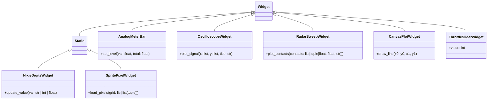

# SDD 0005: CLI/TUI Theming Architecture and Cassette Futurism Instrumentation

- **Status:** Approved
- **Governing ADR:** [ADR 0005: CLI/TUI Theming Architecture and Cassette Futurism Instrumentation](file:///home/michael/src/github.com/mnaatjes/ed-ui/architecture/adr/0005_cli_tui_theming_and_cassette_futurism_instrumentation.md)

---

## 1. Introduction & Objectives

This Software Design Document specifies the technical design, token contract, and hardware widget implementations for the theme subsystem and Cassette Futurism components within `ed-ui-cli`.

### 1.1 Goals
1. Provide a decoupled, immutable theme model (`UiTheme`) governing semantic color tokens, text styles, and border structures.
2. Establish automatic bridging between `UiTheme` and both Rich (`rich.theme.Theme`) and Textual (`textual.theme.Theme`).
3. Deliver built-in presets: `default` (modern cockpit cyan/orange), `cassette_futurism` (P4 amber phosphor with heavy mechanical bevels), and `phosphor_green` (P31 CRT green).
4. Implement specialized retro instrumentation widgets:
   - `NixieDigitsWidget` (Textual `Digits`)
   - `AnalogMeterBar` (Textual `ProgressBar`)
   - `OscilloscopeWidget` & `RadarSweepWidget` (`textual-plotext`)
   - `SpritePixelWidget` (`rich-pixels`)
   - `CanvasPlotWidget` (`textual-canvas`)
   - `ThrottleSliderWidget` (`textual-slider`)
5. Maintain 100% test coverage and strict type annotations across the newly introduced modules.

---

## 2. Design Tokens & Theme Subsystem

### 2.1 Token Schema (`ed_ui_cli.themes.tokens`)

```python
from dataclasses import dataclass
from rich.theme import Theme as RichTheme
from textual.theme import Theme as TextualTheme

@dataclass(frozen=True)
class UiTheme:
    name: str
    display_name: str
    description: str

    # Core Palette
    background: str
    surface: str
    panel: str
    primary: str
    secondary: str
    accent: str

    # Diagnostic & Semantic Alerts
    success: str
    warning: str
    error: str
    muted: str

    # Typography & Hardware Frame
    border_style: str  # "round" | "heavy" | "ascii" | "tall"
    dark: bool = True

    def to_rich_theme(self) -> RichTheme:
        return RichTheme({
            "ui.primary": self.primary,
            "ui.secondary": self.secondary,
            "ui.surface": self.surface,
            "ui.panel": self.panel,
            "ui.accent": self.accent,
            "ui.success": self.success,
            "ui.warning": self.warning,
            "ui.error": self.error,
            "ui.muted": self.muted,
        })

    def to_textual_theme(self) -> TextualTheme:
        return TextualTheme(
            name=self.name,
            primary=self.primary,
            secondary=self.secondary,
            accent=self.accent,
            warning=self.warning,
            error=self.error,
            success=self.success,
            background=self.background,
            surface=self.surface,
            panel=self.panel,
            dark=self.dark,
        )

    def generate_tcss(self) -> str:
        """Generate global TCSS variables and component overrides."""
        ...
```

### 2.2 Canonical Presets (`ed_ui_cli.themes.presets`)

1. **`DEFAULT_THEME` (`"default"`):**
   * Primary: `#00e5ff` (Electric Cyan)
   * Secondary: `#ff9900` (Elite Orange)
   * Background: `#0d1117`, Surface: `#161b22`, Panel: `#21262d`
   * Border: `"round"`

2. **`CASSETTE_FUTURISM_THEME` (`"cassette_futurism"`):**
   * Primary: `#ffb000` (P4 Phosphor Amber Glow)
   * Secondary: `#7a5500` (Dim Analog Amber)
   * Accent: `#00f0ff` (Diagnostic Cyan)
   * Background: `#111417`, Surface: `#1a1d21`, Panel: `#22262b`
   * Border: `"heavy"` (or `"ascii"`)

3. **`PHOSPHOR_GREEN_THEME` (`"phosphor_green"`):**
   * Primary: `#33ff00` (P31 Phosphor Green)
   * Secondary: `#008800` (Dim Phosphor)
   * Accent: `#66ffff` (Signal Cyan)
   * Background: `#0a100a`, Surface: `#121a12`, Panel: `#182418`
   * Border: `"heavy"`

---

## 3. Hardware Instrumentation Widgets

### 3.1 Component Architecture



1. **`NixieDigitsWidget` (`ed_ui_cli.tui.components.instrumentation`):**
   Wraps Textual `Digits`. Formats telemetry outputs (speed in km/s, FSD countdown, target distance) into oversized, high-contrast segmented digits.
2. **`AnalogMeterBar`:**
   Wraps Textual `ProgressBar`. Formats reactor power, heat dissipation, and shield percentages into discrete stepped LED analog meters.
3. **`OscilloscopeWidget` & `RadarSweepWidget`:**
   Wraps `textual-plotext.PlotextPlot`. Renders live sinusoidal sensor waves, spectral scans, and 2D polar radar sweeps.
4. **`SpritePixelWidget`:**
   Wraps `rich-pixels.Pixels`. Displays low-res 8-bit vessel silhouettes, flight emblems, or directional orientation vectors.
5. **`CanvasPlotWidget`:**
   Wraps `textual-canvas.Canvas`. Provides an interactive character coordinate canvas for custom vector tactical overlays.
6. **`ThrottleSliderWidget`:**
   Wraps `textual-slider.Slider`. Emulates physical throttle levers and power distributor potentiometers (SYS/ENG/WEP).

---

## 4. Verification & Testing Plan

1. **Unit Tests:**
   * Verify `UiTheme` serialization and converter bridges (`to_rich_theme()`, `to_textual_theme()`).
   * Verify `ThemeRegistry` lookup, registration, and fallback handling.
2. **Widget Tests:**
   * Headless Textual pilot testing: Instantiate each instrumentation widget inside an active test application.
   * Verify updates to `NixieDigitsWidget`, `AnalogMeterBar`, `OscilloscopeWidget`, `SpritePixelWidget`, `CanvasPlotWidget`, and `ThrottleSliderWidget`.
3. **Integration Verification:**
   * Verify that launching `TelemetryConsoleApp(theme="cassette_futurism")` mounts without style or layout exceptions.
